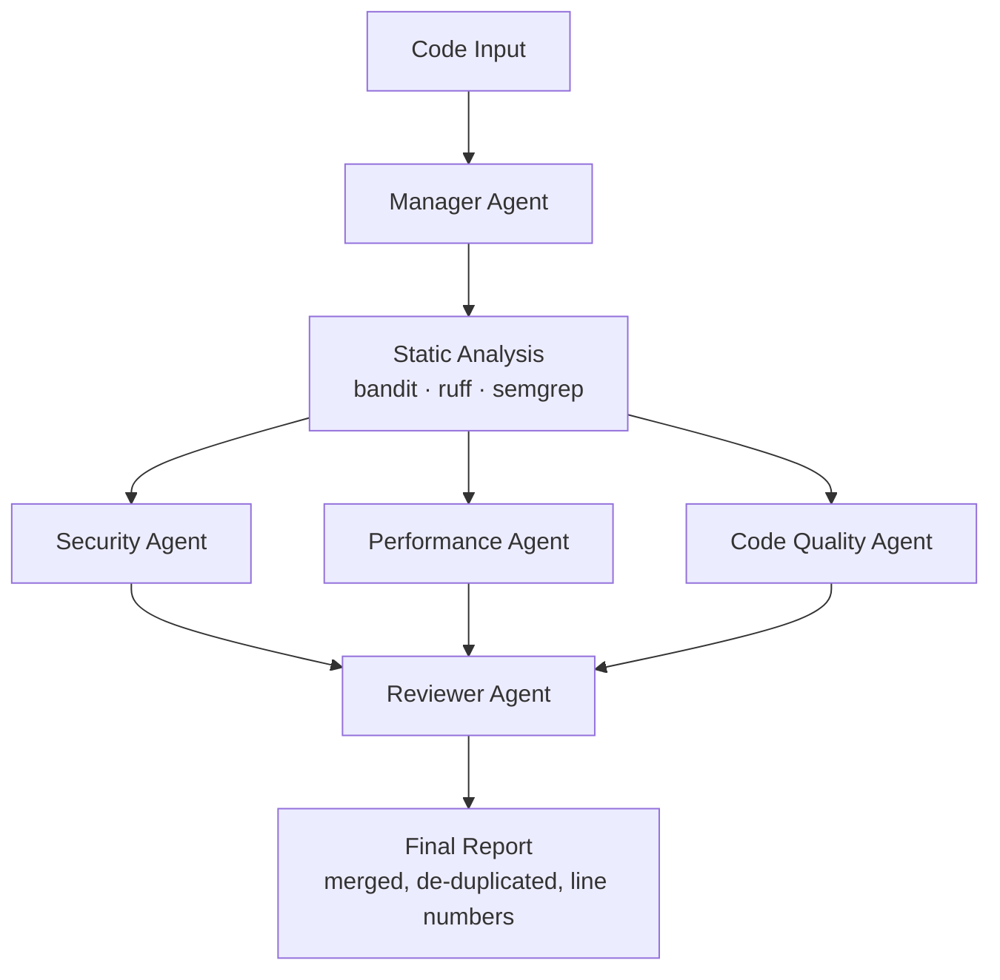

# 🚀 Decentralized Multi-Agent Code Auditor

An AI-powered, multi-agent, local-first code auditing system.

---

## ✨ Features

- 🧠 **Multi-Agent Architecture**: Collaborative agents (Manager, Security, Performance, Quality, Reviewer) orchestrated via LangGraph.
- 🔬 **Static Analysis + AI**: bandit and ruff (plus semgrep, if installed) scan every file first with exact line numbers; the AI agents are told what the tools found and look for what they missed. Duplicate reports are merged into one finding.
- 📍 **Verified Line Numbers**: Every finding shows where it is. AI findings only get a line when their quoted code is actually found in the file — never a guess.
- 📊 **Benchmark**: Labeled sample files measure how many real issues are found and how many reports are wrong (see *Benchmark*).
- 📦 **Three Ways In**: Audit a public GitHub repository (any `github.com/owner/repo` or `/tree/branch` URL), upload source files or a `.zip`, or paste code with a language selector.
- 🗂️ **Persistent History**: Every audit is stored in a local SQLite file, so past reports survive restarts.
- 🎨 **Clean, Fast UI**: Dark editorial interface with CSS-driven transitions, lazy-loaded heavy libraries, and no exit-animation lag.
- ⚡ **Real-Time Streaming**: Live execution tracking via Server-Sent Events (SSE).
- 📈 **Incremental Results**: Audit results stream into the UI precisely as each file finishes.
- 🎚️ **Scan Depth**: *Quick* runs only the Security agent (fastest); *Full* runs Security, Performance, Quality and the Reviewer.
- 🔒 **100% Local Inference**: Powered by Ollama. Your code never leaves your machine.
- 💸 **Zero Cost**: No API keys, no paid services, no cloud. Everything runs on your own hardware.

---

## 🧠 How It Works



---

## 🛠️ Tech Stack

**Backend**
- Python 3.12+
- FastAPI (Async endpoints & BackgroundTasks)
- LangGraph (Agent Orchestrator)
- bandit, ruff, semgrep (optional) for static analysis
- ChromaDB (optional "memory" of past audits; not installed by default: `pip install -r requirements-memory.txt` and set `MEMORY_ENABLED=true`)

**Frontend**
- Next.js 16 (App Router)
- React 19 + framer-motion (nav indicator only)
- Tailwind CSS 4, Recharts, React Flow (both lazy-loaded)

**AI Models**
- Ollama (LLaMA 3.2 or DeepSeek-Coder)

---

## ⚡ Real-Time Streaming

The system leverages Server-Sent Events (SSE) to deliver real-time agent activity logs and asynchronous incremental results to the frontend.
**Example Event Stream:**
```json
data: {
  "type": "log",
  "data": {
    "agent": "Security Agent",
    "message": "Scanning for vulnerabilities...",
    "level": "info"
  }
}
```

---

## 🐳 Quick Start with Docker

The fastest way to run everything (frontend, backend, Ollama and semgrep) is Docker:

```bash
git clone https://github.com/urumb/multi-agent-code-auditor.git
cd multi-agent-code-auditor
docker compose up --build
```

Open http://localhost:3000. The first start downloads the model (`qwen2.5-coder:3b`, ~2 GB) into a Docker volume; later starts are quick. Audit history is kept in the `auditor_data` volume.

- **Security:** ports are published on `127.0.0.1` only, so the unauthenticated backend isn't reachable from your network. Ollama isn't published at all.
- **Use the Ollama already on your machine** instead of the bundled one (no second model download):
  ```bash
  OLLAMA_BASE_URL=http://host.docker.internal:11434 docker compose up --build --no-deps frontend backend
  ```
- **Another model:** `MODEL_NAME=qwen2.5-coder:7b docker compose up --build`.
- **Performance:** Docker Desktop on Windows/macOS runs containers in a VM, so CPU inference is slower than a native Ollama install. On a laptop, the native Ollama option above is usually faster.

---

## ⚙️ Manual Setup

### 1. Clone Repository
```bash
git clone https://github.com/urumb/multi-agent-code-auditor.git
cd multi-agent-code-auditor
```

### 2. Backend Setup
```bash
python -m venv .venv

# Windows
.venv\Scripts\activate
# macOS/Linux
# source .venv/bin/activate

pip install -r requirements.txt
cp .env.example .env   # Windows: copy .env.example .env
```

> Git must be installed and on your `PATH` (used to clone GitHub repositories).

### 3. Ollama Setup
Install [Ollama](https://ollama.com/) and run the service locally.
```bash
ollama pull qwen2.5-coder:3b
ollama serve
```

### 4. Start the Backend
Start Ollama first (step 3), then:
```bash
uvicorn backend.app.main:app --port 8000
```

### 5. Start the Frontend
Open a new terminal window:
```bash
cd frontend
npm install
npm run build
npm start
```
`npm run build && npm start` runs the optimized production build and feels much faster than `npm run dev`, which compiles pages on demand. Use `npm run dev` only while editing the UI.

---

## 💻 Usage

1. **Dashboard**: Navigate to `http://localhost:3000/audit`.
2. **Submit Source Code**: Provide a public GitHub URL, upload files or a `.zip`, or paste raw code.
   Supported: `.py .js .jsx .ts .tsx .java .c .cpp .cs .go .rb .php .rs .kt .swift`. Large repos are capped to the `MAX_FILES_PER_AUDIT` smallest files per run (default 25); the report says how many were skipped.
3. **Execute**: Click "Run Audit".
4. **Monitor**: View live logs tracking exactly what the internal agents are analyzing. (You may safely navigate away—the audit continues running in the background and reconnects instantly upon return).
5. **Review**: Read the synthesized structural and security improvements outputted by the Reviewer Agent.

---

## 💻 Command Line

Audit a folder or file without the web UI:

```bash
python main.py scan .                                       # full audit (needs Ollama)
python main.py scan src --static-only --fail-on high        # tools only: fast, no Ollama
python main.py scan . --format sarif -o results.sarif       # SARIF for GitHub code scanning
python main.py scan . --exclude "tests/*" --format json -o report.json
```

- `--fail-on critical|high|medium|low|none` (default `high`): exit code **1** if any finding is at or above that severity, so a script or CI job can stop on serious issues. Exit code **2** means a usage or runtime error.
- `--static-only` runs only bandit/ruff/semgrep: seconds instead of minutes, and no Ollama needed (good for CI).
- `--depth quick` runs only the security agent.
- `--no-cache` re-audits every file (see *Re-audit only changed files*).

## 🔁 Re-audit Only Changed Files

When you audit something again, files that haven't changed reuse their previous result instead of being re-analyzed, which saves minutes per file on a CPU. A result is reused only if *nothing* that affects it changed: the file's content, the scan depth, the model, analysis settings, analyzer versions, and the auditor's own analysis code. Results where the AI failed (e.g. Ollama was down) are never reused. Reused files are marked **unchanged** in the UI.

Turn it off per run with `use_cache: false` (API) or `--no-cache` (CLI), or globally with `CACHE_ENABLED=false`.

## 📤 SARIF Export

**Export SARIF** on the Results and History pages (or `--format sarif` on the command line) saves findings in SARIF 2.1.0, the standard format for code-scanning results. GitHub's code scanning (free for public repositories) and VS Code's SARIF Viewer show each finding at its file and line.

---

## 🔬 Static Analysis

Before the AI agents run, each file is scanned by real analyzers. They never execute your code — they only read it.

| Tool | Languages | Reports | Installed |
|---|---|---|---|
| bandit | Python | Security | Yes (`requirements.txt`) |
| ruff | Python | Quality, Performance | Yes (`requirements.txt`) |
| semgrep | JS / TS (bundled rules in `rules/semgrep.yml`) | Security | Optional, recommended: `pipx install semgrep` |

Install semgrep with `pipx install semgrep` (its own isolated environment), **not** into the project's virtualenv: its dependencies conflict with FastAPI's and ChromaDB's pinned versions. The auditor finds it on your `PATH`. Without it, JS/TS files are covered only by the AI agents, which find far less (see *Benchmark*).

semgrep runs fully offline against the bundled rule file with metrics disabled; nothing is downloaded or uploaded. Point `SEMGREP_RULES` at your own rule file to extend it. Set `STATIC_ANALYSIS_ENABLED=false` to turn the pre-pass off.

---

## 📊 Benchmark

`benchmarks/cases/` holds small sample files with known issues, each marked with a trailing `# EXPECT: <category>` comment (stripped before auditing). The script reports **recall** (share of known issues found) and **precision** (share of reported findings that are real):

```bash
python -m benchmarks.run_benchmark --static-only -v   # tools only, no Ollama needed (~15s)
python -m benchmarks.run_benchmark -v                 # full pipeline, needs Ollama running
```

Run it before and after changing prompts, models or rules to see whether results actually improved.

Measured results (27 labeled issues across 8 files, 2 of them clean):

| Configuration | Found | Precision | False alarms on clean files | Time |
|---|---|---|---|---|
| Static tools only, with semgrep | 24/27 | 96% | 0 | ~15s |
| Static tools only, no semgrep | 18/27 | 95% | 0 | ~7s |
| Tools + AI agents, `qwen2.5-coder:3b` (default), no semgrep | 20/27 | 70% | 4 | ~6 min |
| Tools + AI agents, `llama3.2` 3B, no semgrep | 20/27 | 68% | 6 | ~7 min |

With a small local model the AI agents add little beyond the tools and introduce false positives; they are most useful for issues no rule covers. A larger model (e.g. `qwen2.5-coder:7b`) is worth benchmarking if you have the hardware. The static-only run is also enforced in CI (`tests/test_batch2_findings.py`), so a change that makes the tools miss known issues or flag clean code fails the build.

---

## 🔐 Privacy, Security & Cost

- **Free:** every component is free and open source. There are no API keys, accounts, paid services or cloud calls. CI runs on GitHub Actions, which is free for public repositories.
- **Your code stays on your machine:** the LLM runs in your local Ollama, and the static analyzers only read files locally; nothing executes the audited code. The only network access is cloning a public GitHub repository when you ask for one, and downloading models or packages when you install them.
- **No telemetry:** Next.js usage telemetry is switched off in `frontend/next.config.ts`, ChromaDB's is switched off in `src/utils/memory.py`, semgrep runs with `--metrics=off`, and LangSmith tracing is never enabled.
- **Dependencies are audited:** CI runs `pip-audit` and `npm audit` on every push and once a week, and fails if a known vulnerability appears. For extra coverage, turn on free Dependabot alerts in the repository's *Settings → Code security*.
- Everything the app stores lives in `data/` (audit history database, optional ChromaDB memory); set `DATA_DIR` to move it. Data from older versions in the project root is moved there automatically on first start. `data/`, `.env`, virtualenvs and build output are all in `.gitignore`. They contain your code and findings, so never commit them.
- Locally, login is off and the backend only listens on `localhost` and only allows CORS from `FRONTEND_ORIGINS` (default: `localhost:3000`). Before exposing it to any network, use the production setup in *Deployment* (login, HTTPS, rate limits).
- Private GitHub repositories are not supported (no tokens are ever requested or stored).

---

## 🏎️ Performance Notes

Local LLMs are the bottleneck, especially on CPU-only machines (typically ~10 tokens/s). The pipeline is tuned for that:

- Output is length-capped and constrained to JSON, the model is kept loaded between audits and pre-warmed at startup.
- Small files are analyzed in a single call per agent; larger files are split into ~3000-character chunks (not one call per function).
- LLM calls take turns instead of competing for the same CPU cores (set `LLM_CONCURRENCY` higher only if you have a GPU).
- The Reviewer's executive summary is generated instantly from the merged findings. Set `REVIEWER_USE_LLM=true` to have the model write it instead (one extra call per file).
- Each agent reports up to `MAX_FINDINGS_PER_CHUNK` findings per chunk (default 2). Lower it for speed, raise it for thoroughness; each extra finding costs ~130 output tokens.
- Repository audits skip near-empty files and are capped at `MAX_FILES_PER_AUDIT` files per run (default 25).

Rough timings on a laptop CPU with `qwen2.5-coder:3b`: Quick ~20-35s per file, Full ~1-2 min per file. For faster audits, use *Quick*, or pull a smaller model (`ollama pull qwen2.5-coder:1.5b`) and select it in Settings. Settings only lists models that are actually installed in Ollama.

---

## 🩺 Troubleshooting

| Problem | Fix |
|---|---|
| Header shows **offline** | The backend isn't running on port 8000. Start it (step 4). |
| Audits fail or time out | Make sure Ollama is running (`ollama serve`) and the model is pulled (`ollama pull qwen2.5-coder:3b`). |
| GitHub audit fails immediately | The repo must be public and `git` must be installed. |
| Audit times out or is slow | Use **Quick** scan depth, a smaller model, or audit fewer files. See *Performance Notes*. |
| Model not in Settings list | Only installed models are listed. Run `ollama pull <model>`. |
| UI feels slow | Use `npm run build && npm start` instead of `npm run dev`. |
| Docker model download fails with `x509: certificate signed by unknown authority` | Your network intercepts HTTPS (common on campus/corporate Wi-Fi), so containers can't verify the download. Pull on another network (`docker compose exec ollama ollama pull qwen2.5-coder:3b`), or use the Ollama installed on your machine (see *Quick Start with Docker*). The app still starts without the model. |
| Docker Desktop crashes with "The file cannot be accessed by the system" on a `.sock` file | A leftover socket from an earlier crash. Quit Docker Desktop, rename the folder named in the error (e.g. `%LOCALAPPDATA%\Docker\run` → `run.old`), and start it again. Don't use *Reset to factory defaults*: it deletes all images and volumes. |

---

## 🚀 Deployment

The app is ready to run on a server with login, HTTPS and rate limits, using only free software. On your own laptop none of this is needed: login is off and everything listens on `localhost` only.

**What you need:** a Linux server with Docker and at least 8 GB of RAM (16 GB recommended) for the AI model, and a domain name pointing at it. Oracle Cloud's *Always Free* tier (up to 24 GB RAM, ARM) fits and costs nothing.

**1. Create the login on any machine with this repo:**

```bash
python main.py hash-password      # asks for a password (12+ characters), prints its hash
python main.py new-secret         # prints a random session secret
```

**2. On the server, create `.env`** (never commit it):

```bash
DOMAIN=auditor.example.com
AUTH_USERNAME=admin
AUTH_PASSWORD_HASH=scrypt:16384:8:1:...   # output of hash-password
SESSION_SECRET=...                         # output of new-secret
```

**3. Start it:**

```bash
docker compose -f docker-compose.prod.yml up -d --build
```

Open `https://<your domain>` and sign in.

What the production setup does (`docker-compose.prod.yml`, `deploy/Caddyfile`):

- **Only Caddy is reachable from the internet** (ports 80/443). It gets and renews a free HTTPS certificate from Let's Encrypt automatically, adds security headers, and serves the UI and API from one address (API under `/api`).
- **Login is required** for everything except the health check. Passwords are stored only as scrypt hashes; sessions are signed, HttpOnly, `Secure`, `SameSite=Strict` cookies that expire after `SESSION_TTL_HOURS` (default 12).
- **It refuses to start** if login is switched on but the username, password hash or session secret is missing, instead of running unprotected.
- **Rate limits:** 5 login attempts and 10 audit starts per minute per address, and at most 2 audits running at once (`LOGIN_ATTEMPTS_PER_MINUTE`, `AUDITS_PER_MINUTE`, `MAX_CONCURRENT_AUDITS`).
- The backend, frontend and Ollama aren't published at all; audit history lives in the `auditor_data` volume (back it up with `docker run --rm -v multi-agent-auditor_auditor_data:/data -v "$PWD":/backup alpine tar czf /backup/auditor-data.tgz -C /data .`).

---

## 🗂️ Project Layout

```
backend/app/main.py            FastAPI app: lifespan, CORS, router wiring
backend/app/routers/           HTTP routes: audit (start, stream, cancel), history (+ SARIF), settings, auth
backend/app/security.py        login (scrypt hashes, signed sessions) and rate limiting
backend/app/services/          audit_jobs (running audits), job_store (live jobs), db (SQLite), input_processor
src/graph.py                   LangGraph pipeline: manager -> static analysis -> agents -> reviewer
src/agents/                    Manager, Reviewer, and the Security/Performance/Quality agents (shared base.py)
src/static_analysis.py         bandit / ruff / semgrep pre-pass
src/findings.py                finding schema, line anchoring, merging and de-duplication
src/cli.py, src/sarif.py       command line (python main.py scan) and SARIF export
rules/semgrep.yml              bundled offline semgrep rules (JS/TS)
benchmarks/                    labeled sample files + recall/precision scorer
docker/, docker-compose.yml    local container setup
docker-compose.prod.yml, deploy/  server setup: Caddy (HTTPS), login, rate limits
frontend/                      Next.js UI (browser tests in frontend/e2e)
```

---

## 📜 License

MIT License

---

## 👨‍💻 Author

**urumb**  
GitHub: [https://github.com/urumb](https://github.com/urumb)