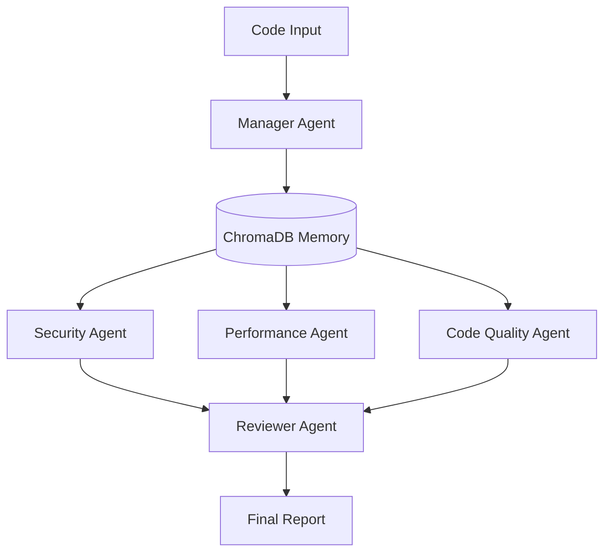

# 🚀 Decentralized Multi-Agent Code Auditor

An AI-powered, multi-agent, local-first code auditing system.

---

## ✨ Features

- 🧠 **Multi-Agent Architecture**: Collaborative agents (Manager, Security, Performance, Quality, Reviewer) orchestrated via LangGraph.
- 📦 **Three Ways In**: Audit a public GitHub repository (any `github.com/owner/repo` or `/tree/branch` URL), upload source files or a `.zip`, or paste code with a language selector.
- 🗂️ **Persistent History**: Every audit is stored in a local SQLite file, so past reports survive restarts.
- 🎨 **Clean, Fast UI**: Dark editorial interface with CSS-driven transitions, lazy-loaded heavy libraries, and no exit-animation lag.
- ⚡ **Real-Time Streaming**: Live execution tracking via Server-Sent Events (SSE).
- 📈 **Incremental Results**: Audit results stream into the UI precisely as each file finishes.
- 🔒 **100% Local Inference**: Powered by Ollama. Your code never leaves your machine.
- 💸 **Zero Cost**: No API keys, no paid services, no cloud. Everything runs on your own hardware.

---

## 🧠 How It Works



---

## 🛠️ Tech Stack

**Backend**
- Python 3.12+
- FastAPI (Async endpoints & BackgroundTasks)
- LangGraph (Agent Orchestestrator)
- ChromaDB (Vector Store)

**Frontend**
- Next.js 16 (App Router)
- React 19 + framer-motion (nav indicator only)
- Tailwind CSS 4, Recharts, React Flow (both lazy-loaded)

**AI Models**
- Ollama (LLaMA 3.2 or DeepSeek-Coder)

---

## ⚡ Real-Time Streaming

The system leverages Server-Sent Events (SSE) to deliver real-time agent activity logs and asynchronous incremental results to the frontend.
**Example Event Stream:**
```json
data: {
  "type": "log",
  "data": {
    "agent": "Security Agent",
    "message": "Scanning for vulnerabilities...",
    "level": "info"
  }
}
```

---

## ⚙️ Setup

### 1. Clone Repository
```bash
git clone https://github.com/urumb/multi-agent-code-auditor.git
cd multi-agent-code-auditor
```

### 2. Backend Setup
```bash
python -m venv .venv

# Windows
.venv\Scripts\activate
# macOS/Linux
# source .venv/bin/activate

pip install -r requirements.txt
cp .env.example .env   # Windows: copy .env.example .env
```

> Git must be installed and on your `PATH` (used to clone GitHub repositories).

### 3. Ollama Setup
Install [Ollama](https://ollama.com/) and run the service locally.
```bash
ollama pull llama3.2
ollama serve
```

### 4. Start the Backend
Start Ollama first (step 3), then:
```bash
uvicorn backend.app.main:app --port 8000
```

### 5. Start the Frontend
Open a new terminal window:
```bash
cd frontend
npm install
npm run build
npm start
```
`npm run build && npm start` runs the optimized production build and feels much faster than `npm run dev`, which compiles pages on demand. Use `npm run dev` only while editing the UI.

---

## 💻 Usage

1. **Dashboard**: Navigate to `http://localhost:3000/audit`.
2. **Submit Source Code**: Provide a public GitHub URL, upload files or a `.zip`, or paste raw code.
   Supported: `.py .js .jsx .ts .tsx .java .c .cpp .cs .go .rb .php .rs .kt .swift`. Large repos are capped to the 60 smallest files per run.
3. **Execute**: Click "Run Audit".
4. **Monitor**: View live logs tracking exactly what the internal agents are analyzing. (You may safely navigate away—the audit continues running in the background and reconnects instantly upon return).
5. **Review**: Read the synthesized structural and security improvements outputted by the Reviewer Agent.

---

## 🔐 Privacy & Git Hygiene

- The audit history database (`audit_history.db`), ChromaDB data, local model weights, `.env`, virtualenvs and build output are all listed in `.gitignore`. They contain your code and findings, so never commit them.
- The backend has no authentication and only allows CORS from `FRONTEND_ORIGINS` (default: `localhost:3000`). Keep it bound to localhost unless you add auth.
- Private GitHub repositories are not supported (no tokens are ever requested or stored).

---

## 🩺 Troubleshooting

| Problem | Fix |
|---|---|
| Header shows **offline** | The backend isn't running on port 8000. Start it (step 4). |
| Audits fail or time out | Make sure Ollama is running (`ollama serve`) and the model is pulled (`ollama pull llama3.2`). |
| GitHub audit fails immediately | The repo must be public and `git` must be installed. |
| UI feels slow | Use `npm run build && npm start` instead of `npm run dev`. |

---

## 🚀 Deployment Note

- **Frontend**: Standard Node.js deployment (Vercel, Netlify, Docker).
- **Backend**: Strongly relies on local LLM capabilities. To maintain complete data privacy, the API server, ChromaDB instance, and Ollama service must all be deployed to a secured environment with adequate local compute (e.g. AWS EC2, bare-metal servers) rather than serverless functions.

---

## 📜 License

MIT License

---

## 👨‍💻 Author

**urumb**  
GitHub: [https://github.com/urumb](https://github.com/urumb)