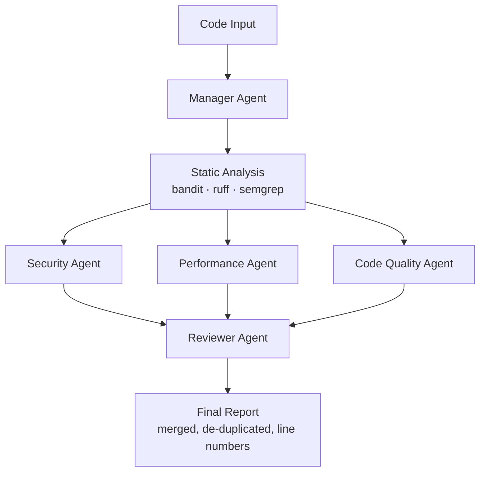

# 🚀 Decentralized Multi-Agent Code Auditor

An AI-powered, multi-agent, local-first code auditing system.

---

## ✨ Features

- 🧠 **Multi-Agent Architecture**: Collaborative agents (Manager, Security, Performance, Quality, Reviewer) orchestrated via LangGraph.
- 🔬 **Static Analysis + AI**: bandit and ruff (plus semgrep, if installed) scan every file first with exact line numbers; the AI agents are told what the tools found and look for what they missed. Duplicate reports are merged into one finding.
- 📍 **Verified Line Numbers**: Every finding shows where it is. AI findings only get a line when their quoted code is actually found in the file — never a guess.
- 📊 **Benchmark**: Labeled sample files measure how many real issues are found and how many reports are wrong (see *Benchmark*).
- 📦 **Three Ways In**: Audit a public GitHub repository (any `github.com/owner/repo` or `/tree/branch` URL), upload source files or a `.zip`, or paste code with a language selector.
- 🗂️ **Persistent History**: Every audit is stored in a local SQLite file, so past reports survive restarts.
- 🎨 **Clean, Fast UI**: Dark editorial interface with CSS-driven transitions, lazy-loaded heavy libraries, and no exit-animation lag.
- ⚡ **Real-Time Streaming**: Live execution tracking via Server-Sent Events (SSE).
- 📈 **Incremental Results**: Audit results stream into the UI precisely as each file finishes.
- 🎚️ **Scan Depth**: *Quick* runs only the Security agent (fastest); *Full* runs Security, Performance, Quality and the Reviewer.
- 🔒 **100% Local Inference**: Powered by Ollama. Your code never leaves your machine.
- 💸 **Zero Cost**: No API keys, no paid services, no cloud. Everything runs on your own hardware.

---

## 🧠 How It Works



---

## 🛠️ Tech Stack

**Backend**
- Python 3.12+
- FastAPI (Async endpoints & BackgroundTasks)
- LangGraph (Agent Orchestrator)
- bandit, ruff, semgrep (optional) for static analysis
- ChromaDB (optional "memory" of past audits; off by default, enable with `MEMORY_ENABLED=true`)

**Frontend**
- Next.js 16 (App Router)
- React 19 + framer-motion (nav indicator only)
- Tailwind CSS 4, Recharts, React Flow (both lazy-loaded)

**AI Models**
- Ollama (LLaMA 3.2 or DeepSeek-Coder)

---

## ⚡ Real-Time Streaming

The system leverages Server-Sent Events (SSE) to deliver real-time agent activity logs and asynchronous incremental results to the frontend.
**Example Event Stream:**
```json
data: {
  "type": "log",
  "data": {
    "agent": "Security Agent",
    "message": "Scanning for vulnerabilities...",
    "level": "info"
  }
}
```

---

## 🐳 Quick Start with Docker

The fastest way to run everything (frontend, backend, Ollama and semgrep) is Docker:

```bash
git clone https://github.com/urumb/multi-agent-code-auditor.git
cd multi-agent-code-auditor
docker compose up --build
```

Open http://localhost:3000. The first start downloads the model (`llama3.2`, ~2 GB) into a Docker volume; later starts are quick. Audit history is kept in the `auditor_data` volume.

- **Security:** ports are published on `127.0.0.1` only, so the unauthenticated backend isn't reachable from your network. Ollama isn't published at all.
- **Use the Ollama already on your machine** instead of the bundled one (no second model download):
  ```bash
  OLLAMA_BASE_URL=http://host.docker.internal:11434 docker compose up --build --no-deps frontend backend
  ```
- **Another model:** `MODEL_NAME=qwen2.5-coder:7b docker compose up --build`.
- **Performance:** Docker Desktop on Windows/macOS runs containers in a VM, so CPU inference is slower than a native Ollama install. On a laptop, the native Ollama option above is usually faster.

---

## ⚙️ Manual Setup

### 1. Clone Repository
```bash
git clone https://github.com/urumb/multi-agent-code-auditor.git
cd multi-agent-code-auditor
```

### 2. Backend Setup
```bash
python -m venv .venv

# Windows
.venv\Scripts\activate
# macOS/Linux
# source .venv/bin/activate

pip install -r requirements.txt
cp .env.example .env   # Windows: copy .env.example .env
```

> Git must be installed and on your `PATH` (used to clone GitHub repositories).

### 3. Ollama Setup
Install [Ollama](https://ollama.com/) and run the service locally.
```bash
ollama pull llama3.2
ollama serve
```

### 4. Start the Backend
Start Ollama first (step 3), then:
```bash
uvicorn backend.app.main:app --port 8000
```

### 5. Start the Frontend
Open a new terminal window:
```bash
cd frontend
npm install
npm run build
npm start
```
`npm run build && npm start` runs the optimized production build and feels much faster than `npm run dev`, which compiles pages on demand. Use `npm run dev` only while editing the UI.

---

## 💻 Usage

1. **Dashboard**: Navigate to `http://localhost:3000/audit`.
2. **Submit Source Code**: Provide a public GitHub URL, upload files or a `.zip`, or paste raw code.
   Supported: `.py .js .jsx .ts .tsx .java .c .cpp .cs .go .rb .php .rs .kt .swift`. Large repos are capped to the `MAX_FILES_PER_AUDIT` smallest files per run (default 25); the report says how many were skipped.
3. **Execute**: Click "Run Audit".
4. **Monitor**: View live logs tracking exactly what the internal agents are analyzing. (You may safely navigate away—the audit continues running in the background and reconnects instantly upon return).
5. **Review**: Read the synthesized structural and security improvements outputted by the Reviewer Agent.

---

## 🔬 Static Analysis

Before the AI agents run, each file is scanned by real analyzers. They never execute your code — they only read it.

| Tool | Languages | Reports | Installed |
|---|---|---|---|
| bandit | Python | Security | Yes (`requirements.txt`) |
| ruff | Python | Quality, Performance | Yes (`requirements.txt`) |
| semgrep | JS / TS (bundled rules in `rules/semgrep.yml`) | Security | Optional, recommended: `pipx install semgrep` |

Install semgrep with `pipx install semgrep` (its own isolated environment), **not** into the project's virtualenv: its dependencies conflict with FastAPI's and ChromaDB's pinned versions. The auditor finds it on your `PATH`. Without it, JS/TS files are covered only by the AI agents, which find far less (see *Benchmark*).

semgrep runs fully offline against the bundled rule file with metrics disabled; nothing is downloaded or uploaded. Point `SEMGREP_RULES` at your own rule file to extend it. Set `STATIC_ANALYSIS_ENABLED=false` to turn the pre-pass off.

---

## 📊 Benchmark

`benchmarks/cases/` holds small sample files with known issues, each marked with a trailing `# EXPECT: <category>` comment (stripped before auditing). The script reports **recall** (share of known issues found) and **precision** (share of reported findings that are real):

```bash
python -m benchmarks.run_benchmark --static-only -v   # tools only, no Ollama needed (~15s)
python -m benchmarks.run_benchmark -v                 # full pipeline, needs Ollama running
```

Run it before and after changing prompts, models or rules to see whether results actually improved.

Measured results (27 labeled issues across 8 files, 2 of them clean):

| Configuration | Found | Precision | False alarms on clean files | Time |
|---|---|---|---|---|
| Static tools only, with semgrep | 24/27 | 96% | 0 | ~15s |
| Static tools only, no semgrep | 18/27 | 95% | 0 | ~7s |
| Tools + AI agents (`llama3.2` 3B, CPU), no semgrep | 18/27 | 58% | 8 | ~15 min |

With a small local model the AI agents add little beyond the tools and introduce false positives; they are most useful for issues no rule covers. A larger model (e.g. `qwen2.5-coder:7b`) is worth benchmarking if you have the hardware. The static-only run is also enforced in CI (`tests/test_batch2_findings.py`), so a change that makes the tools miss known issues or flag clean code fails the build.

---

## 🔐 Privacy & Git Hygiene

- Everything the app stores lives in `data/` (audit history database, optional ChromaDB memory); set `DATA_DIR` to move it. Data from older versions in the project root is moved there automatically on first start. `data/`, `.env`, virtualenvs and build output are all in `.gitignore`. They contain your code and findings, so never commit them.
- The backend has no authentication and only allows CORS from `FRONTEND_ORIGINS` (default: `localhost:3000`). Keep it bound to localhost unless you add auth.
- Private GitHub repositories are not supported (no tokens are ever requested or stored).

---

## 🏎️ Performance Notes

Local LLMs are the bottleneck, especially on CPU-only machines (typically ~10 tokens/s). The pipeline is tuned for that:

- Output is length-capped and constrained to JSON, the model is kept loaded between audits and pre-warmed at startup.
- Small files are analyzed in a single call per agent; larger files are split into ~3000-character chunks (not one call per function).
- LLM calls take turns instead of competing for the same CPU cores (set `LLM_CONCURRENCY` higher only if you have a GPU).
- The Reviewer's executive summary is generated instantly from the merged findings. Set `REVIEWER_USE_LLM=true` to have the model write it instead (one extra call per file).
- Each agent reports up to `MAX_FINDINGS_PER_CHUNK` findings per chunk (default 2). Lower it for speed, raise it for thoroughness; each extra finding costs ~130 output tokens.
- Repository audits skip near-empty files and are capped at `MAX_FILES_PER_AUDIT` files per run (default 25).

Rough timings on a laptop CPU with `llama3.2`: Quick ~20-35s per file, Full ~1-2 min per file. For faster audits, use *Quick*, or pull a smaller model (`ollama pull llama3.2:1b`) and select it in Settings. Settings only lists models that are actually installed in Ollama.

---

## 🩺 Troubleshooting

| Problem | Fix |
|---|---|
| Header shows **offline** | The backend isn't running on port 8000. Start it (step 4). |
| Audits fail or time out | Make sure Ollama is running (`ollama serve`) and the model is pulled (`ollama pull llama3.2`). |
| GitHub audit fails immediately | The repo must be public and `git` must be installed. |
| Audit times out or is slow | Use **Quick** scan depth, a smaller model, or audit fewer files. See *Performance Notes*. |
| Model not in Settings list | Only installed models are listed. Run `ollama pull <model>`. |
| UI feels slow | Use `npm run build && npm start` instead of `npm run dev`. |
| Docker model download fails with `x509: certificate signed by unknown authority` | Your network intercepts HTTPS (common on campus/corporate Wi-Fi), so containers can't verify the download. Pull on another network (`docker compose exec ollama ollama pull llama3.2`), or use the Ollama installed on your machine (see *Quick Start with Docker*). The app still starts without the model. |
| Docker Desktop crashes with "The file cannot be accessed by the system" on a `.sock` file | A leftover socket from an earlier crash. Quit Docker Desktop, rename the folder named in the error (e.g. `%LOCALAPPDATA%\Docker\run` → `run.old`), and start it again. Don't use *Reset to factory defaults*: it deletes all images and volumes. |

---

## 🚀 Deployment Note

- **Frontend**: Standard Node.js deployment (Vercel, Netlify, Docker).
- **Backend**: Strongly relies on local LLM capabilities. To maintain complete data privacy, the API server, ChromaDB instance, and Ollama service must all be deployed to a secured environment with adequate local compute (e.g. AWS EC2, bare-metal servers) rather than serverless functions.

---

## 🗂️ Project Layout

```
backend/app/main.py            FastAPI app: lifespan, CORS, router wiring
backend/app/routers/           HTTP routes: audit (start + SSE stream), history, settings
backend/app/services/          audit_jobs (running audits), job_store (live jobs), db (SQLite), input_processor
src/graph.py                   LangGraph pipeline: manager -> static analysis -> agents -> reviewer
src/agents/                    Manager, Reviewer, and the Security/Performance/Quality agents (shared base.py)
src/static_analysis.py         bandit / ruff / semgrep pre-pass
src/findings.py                finding schema, line anchoring, merging and de-duplication
rules/semgrep.yml              bundled offline semgrep rules (JS/TS)
benchmarks/                    labeled sample files + recall/precision scorer
docker/, docker-compose.yml    container setup
frontend/                      Next.js UI
```

---

## 📜 License

MIT License

---

## 👨‍💻 Author

**urumb**  
GitHub: [https://github.com/urumb](https://github.com/urumb)